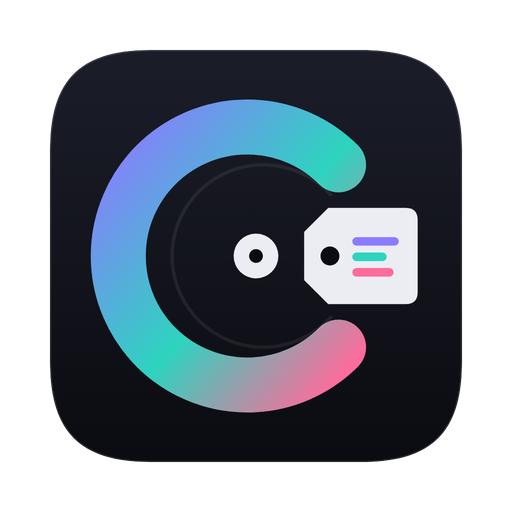

<p align="center"></p>

<h1 align="center">CrateTag</h1>

<p align="center">Find the release year and genre for your MP3s and write them safely. Built for DJs who use Serato.</p>

## What it does

- Reads your Serato crates (including crates on external drives) and All Songs, or any folder of MP3s.
- Looks up each track's year and genre on MusicBrainz, Discogs and Deezer, with Apple iTunes as a backup.
- Lets you review every change, edit artist, title, year and genre by hand, and write only what you choose.
- Changes only those tags. Serato cue points, loops, colors, beatgrids and waveforms in each file are left untouched, and Serato's crate files are never modified.
- Keeps an undo log so any write can be reversed.

## Install (macOS)

1. On this page, click the green **Code** button, then **Download ZIP**. If the zip isn't unzipped automatically, double-click it in your Downloads folder. You'll get a folder called **CrateTag-main**.
2. Open **Terminal** (Applications > Utilities > Terminal), paste this, and press Return:

   ```
   bash ~/Downloads/CrateTag-main/"Install CrateTag.command"
   ```

   The installer checks for Python 3.10 or newer and Homebrew, installs anything missing (macOS may ask for your Mac password; nothing shows as you type), builds CrateTag.app and puts it in Applications. The first time can take 5 to 15 minutes.

Keep the CrateTag-main folder: CrateTag updates itself from it.

After that, CrateTag checks this repository for new versions when it opens. Click **Update to …** at the bottom right (or choose CrateTag > Check for Updates…) to install one.

The full guide, with screenshots and troubleshooting, is in `CrateTag Guide.pdf`.

## Run from source

```
./run_from_source.sh
```

Tests: `./.venv/bin/python -m pytest -q`

## Data sources

MusicBrainz, Discogs (free personal token), Deezer, Apple iTunes Search API, and optionally AcoustID for audio fingerprints.

## Credits

Created by DJ CASE (@djcaseboston).
